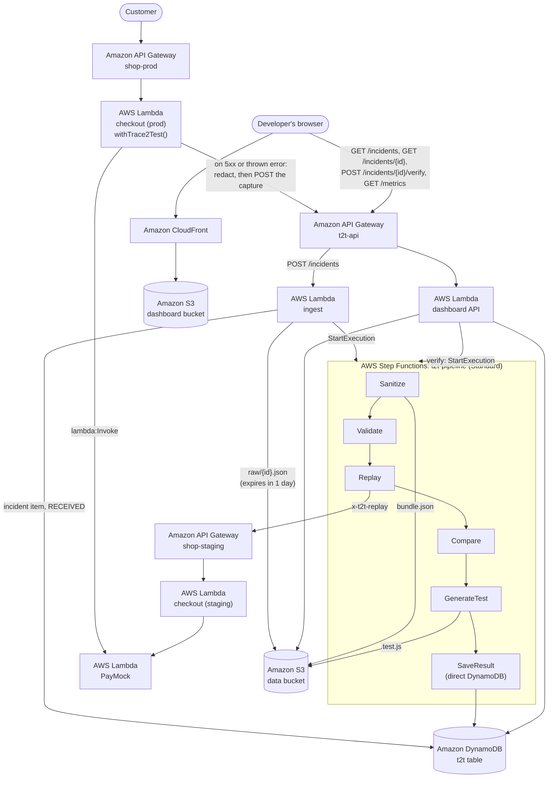
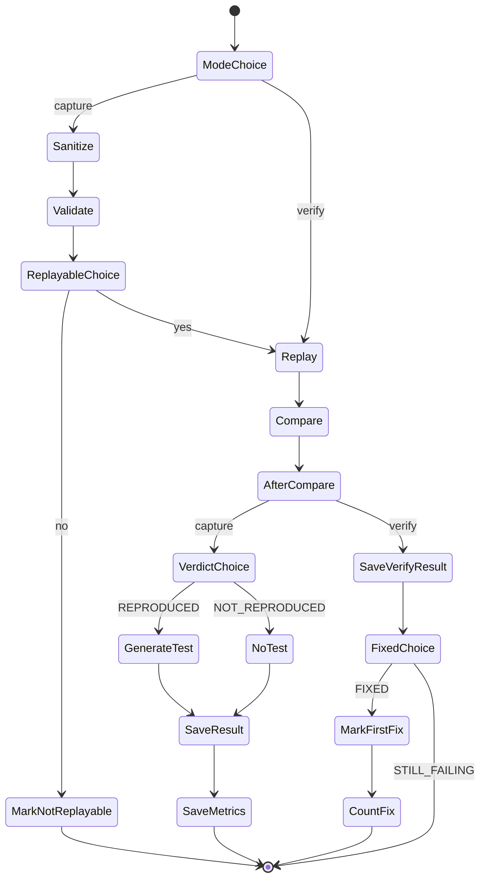

# Architecture

A failure flows one way: the capture wrapper, the ingest API, the Step Functions workflow, then the dashboard reads the result.

## What each service does

| Service | Job in this build |
| --- | --- |
| Amazon API Gateway (HTTP API) | Three APIs: shop-prod, shop-staging, and t2t-api for ingest and the dashboard. Ingest is throttled at 10 requests per second, burst 20. |
| AWS Lambda | Checkout (prod and staging), PayMock, ingest, the five workflow tasks, and the dashboard API. arm64, 256 MB. |
| AWS Step Functions (Standard) | Runs the pipeline in two modes (capture and verify), with retries, choice states and a catch-all failure path. |
| Amazon S3 | Raw captures (1-day expiry), sanitized bundles, replay results and generated tests (30 days), plus the dashboard's static files. |
| Amazon DynamoDB (on-demand) | Incident metadata, per-step timings, fingerprint counts and metrics. TTL removes items after 30 days. |
| Amazon CloudFront | HTTPS in front of the private dashboard bucket, with origin access control. |

## The workflow

Any unhandled error in any task goes to `MarkPipelineFailed`, then to a `Fail` state. `SaveResult`, `SaveMetrics`, `SaveVerifyResult`, `MarkFirstFix`, `CountFix`, `MarkNotReplayable` and `MarkPipelineFailed` are direct DynamoDB integrations, with no Lambda in between.

## Step Functions execution graph

<!-- SCREENSHOT: after the first deploy, run scripts/trigger-bug.sh, open the execution in the Step Functions console, and save the graph view here as docs/execution-graph.png. -->

_Screenshot to be added after the first deployment._
