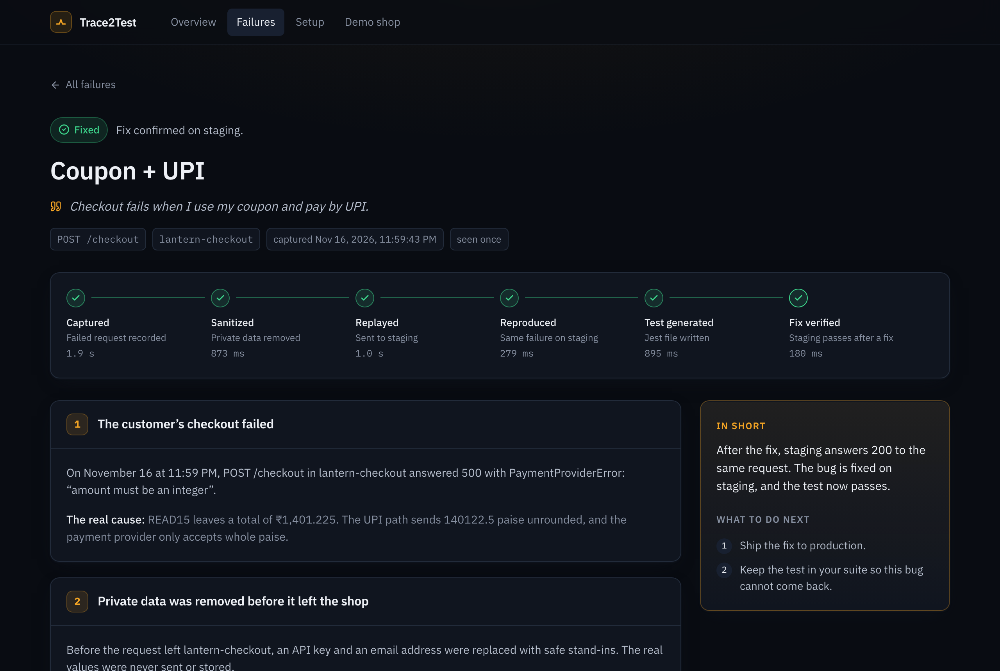
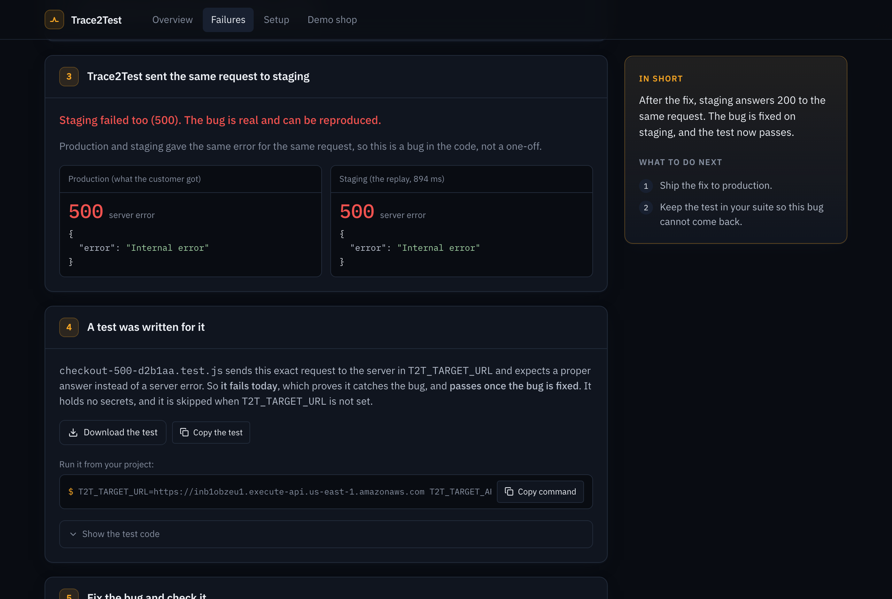
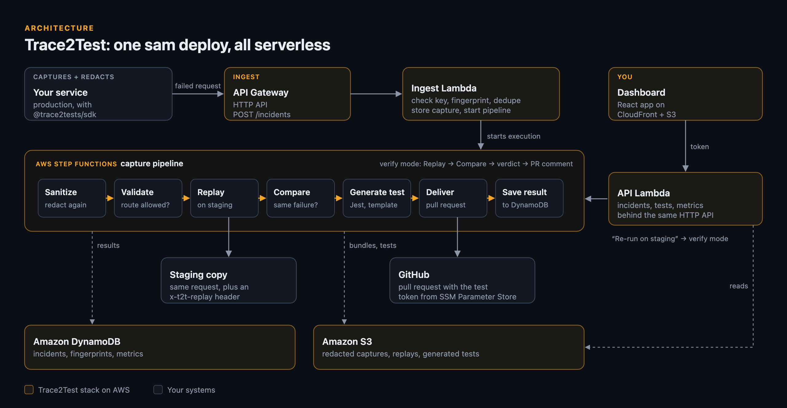

# The bug only happens with one exact request. So keep the request.

A support ticket comes in: *"Checkout fails when I use my coupon and pay by UPI."*

You open the logs and find `500 Internal Server Error` and a stack trace. You don't find what was in the basket, which coupon, which payment method or which address. You try a few carts on staging. Everything works. The ticket gets closed as "can't reproduce", and next week the same customer hits the same bug.

The information needed to reproduce the bug existed for exactly one moment: inside the request that failed. **Trace2Test** keeps that request, removes the private data, checks that the failure is real on staging, and writes a regression test that fails today and passes once the bug is fixed.

[▶ Watch the 2½-minute demo](media/trace2test-demo.mp4), recorded against the live AWS deployment.



## What happens when a request fails

1. **Capture.** A small SDK wraps your handler. When a request throws or answers 5xx, it records the method, path, query, headers and body. Successful requests cost nothing: no network call, no buffering.
2. **Redact, inside your service.** Before anything is sent, emails, card numbers, phone numbers, JWTs, bearer tokens, API keys and passwords are replaced with *valid stand-ins*: `asha.k@example.com` becomes `user_520f@redacted.example`, still a real-looking email address. That matters, because a request with `[REDACTED]` in the email field fails validation for a different reason and proves nothing.
3. **Redact again, and count leaks.** The pipeline runs the same redaction on arrival. Anything the SDK missed is caught and counted as a leak, so you can see if a service is misconfigured.
4. **Replay on staging.** The redacted request is sent to the staging copy of the service with an `x-t2t-replay` header, and only on routes you have marked as safe to replay.
5. **Compare.** If staging also fails, the bug is real and lives in the code, not in a flaky dependency or a one-off. If staging succeeds, the incident is marked *not reproduced*, and no test is written for a bug that isn't there.
6. **Write the test.** A Jest test that sends that exact request and expects a proper answer instead of a server error. It fails today and passes once the bug is fixed.
7. **Deliver it.** Optionally, as a GitHub pull request on its own branch, with the redacted request and the error in the description.
8. **Prove the fix.** After a fix is deployed to staging, Trace2Test replays the same request again. When staging answers 2xx, the incident becomes **Fixed** and the pull request gets a comment saying so.

In the deployed demo, the steps took 873 ms to sanitize, 1.0 s to replay, 279 ms to compare and 895 ms to write the test. On the first run after deploying, cold Lambdas included, it took 25 seconds from the failed checkout to a ready test, measured by a script polling the API once a second.



## The test is not written by an AI

A natural question: is an LLM writing these tests? No, and on purpose. The test is generated from a fixed template, filled with the captured request and the observed responses. That makes it:

- **Deterministic:** the same incident always produces the same file, so a re-run of the pipeline doesn't produce a noisy diff.
- **Reviewable:** every generated test has the same shape. A reviewer reads it once and then only looks at the request.
- **Honest:** it asserts only what was observed, which is that this request got a server error. It doesn't guess what the right business answer should be.

The test is skipped when `T2T_TARGET_URL` is not set, so it never breaks a suite that has no server to call.

## Adding it to a service

```bash
npm install @trace2tests/sdk
```

On AWS Lambda (API Gateway HTTP or REST APIs, function URLs, ALB):

```ts
import { withTrace2Test } from '@trace2tests/sdk';

export const handler = withTrace2Test(myHandler, {
  service: 'orders',
  stage: process.env.STAGE,          // only 'prod' or 'production' captures
  ingestUrl: process.env.T2T_INGEST_URL,
  ingestKey: process.env.T2T_INGEST_KEY,
});
```

On Express:

```ts
import { trace2testExpress } from '@trace2tests/sdk';

const t2t = trace2testExpress(config);
app.use(t2t.capture);       // first
app.use(express.json());
// ...routes...
app.use(t2t.recordErrors);  // after the routes, before your error handler
```

Fastify is one line: `trace2testFastify(app, config)`.

A few rules the SDK follows, because it sits in your production request path:

- **It never changes your response and never throws.** If Trace2Test is down, your service doesn't notice.
- **On Lambda** the capture is sent before the handler returns, because Lambda freezes after that, with a 1.5 s budget. **On Express and Fastify** it is sent after the response has gone out, so it adds no latency.
- **No runtime dependencies**, ESM and CommonJS, Node 18+.

### Replays and side effects

Replaying a failed checkout on staging must not send a second receipt email. The SDK marks replays, and you skip side effects in one line:

```ts
import { isReplay } from '@trace2tests/sdk';

if (!isReplay(event)) await sendReceiptEmail(order);
```

Replay is also opt-in per route. A service with no staging target configured still gets a redacted capture and a test, marked *unverified*.

## Architecture

Everything is serverless and deploys with one `sam deploy`:



- **API Gateway HTTP API** for ingest and the dashboard API.
- **Lambda** (Node 22, arm64) for each pipeline step.
- **Step Functions** (Standard) to orchestrate. Results go straight to DynamoDB through direct service integrations, with conditional writes so a retried state never counts an incident twice.
- **DynamoDB** for incidents, fingerprints (so a failure hitting a thousand customers is one incident, *seen 1,000 times*) and metrics.
- **S3** for the redacted bundle, replay results and generated tests.
- **CloudFront** for the React dashboard.
- **SSM Parameter Store** for the GitHub token, read at runtime and never put in an environment variable.

The core stack and the demo shop are separate templates. Your services only need the core.

## A bug that only AWS could find

Deploying this to a real account for the first time found a bug that 114 local tests had missed. Confirming a fix failed with:

```
ValidationException: Invalid UpdateExpression: Attribute name is a reserved keyword; reserved keyword: fixed
```

The metrics update was `ADD fixed :one`, and `fixed` is one of DynamoDB's several hundred reserved words. The local stack uses an in-memory store that doesn't know the list, so every test passed.

The fix was to stop picking safe names by hand. Every attribute in every expression is now written as `#name`, the alias map is derived from the expression, and a test fails the build if any expression contains a bare attribute name. Bugs that only appear with real input are what this project is about, so it was fitting to hit one while deploying it.

## Limits

- Node.js services, and JSON request bodies up to 256 KB.
- Replay needs a staging copy that behaves like production. Without one, you get the capture and an unverified test.
- A 5xx is the signal. A wrong answer delivered with a `200` is not caught.
- The generated test proves *the server no longer errors on this request*. It doesn't prove the business answer is right. That assertion is still yours to add.

## Try it

- Code (MIT): [github.com/Poobalan1210/trace2test](https://github.com/Poobalan1210/trace2test)
- SDK: [`@trace2tests/sdk` on npm](https://www.npmjs.com/package/@trace2tests/sdk)
- Deploy your own: `sam build && sam deploy --guided`, or with the demo bookshop, `sam build --config-env demo && sam deploy --config-env demo --guided`

If a support ticket in your team has ever been closed as "can't reproduce", I'd like to hear whether this would have caught it.
